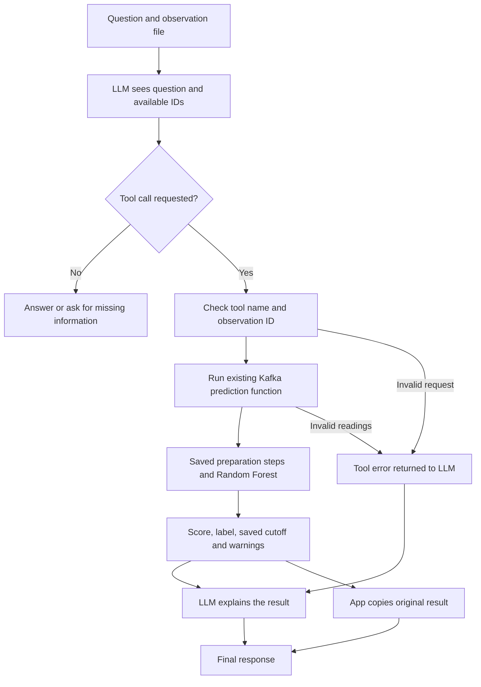

# AI assistant + ML model

Ask a question about a machine observation. A local Ollama LLM chooses the prediction tool. The app runs the existing AI4I model. The LLM explains the result, and the app prints the original result separately.

All new code is in this folder. It reads the existing files in `../artifacts/` and calls `predict_event` from `../src/consumer.py`. It does not retrain the model or change the Kafka scripts. No Kafka broker is needed for this part of the demo.

Local setup and verification are complete in this checkout. See [TESTING.md](TESTING.md) for the tested scenarios. To start now, activate `.venv` and run `python demo.py single`.

## Model choice

The default is **`qwen3.5:9b`**, with thinking disabled and temperature zero. It supports tool calling and its default download is about 6.6 GB. This is a practical choice for the local 24 GB Mac and this short tool-calling task, not a claim that it wins every benchmark. An 8,192-token context keeps this small demo manageable. First use takes longer while Ollama loads the model.

Official references: [Qwen3.5 9B](https://ollama.com/library/qwen3.5:9b), [Ollama tool calling](https://docs.ollama.com/capabilities/tool-calling), [chat API](https://docs.ollama.com/api/chat).

You can use another locally downloaded tool-capable model with `--model`. General chat ability alone does not guarantee reliable tool calls. The app rejects Ollama cloud models.

## Setup

Run these commands from `agent-ml-harness`:

```sh
python3 -m venv .venv
source .venv/bin/activate
python -m pip install -r requirements.txt
ollama pull qwen3.5:9b
```

Keep Ollama running. If its desktop app is not running, start `ollama serve` in another terminal. Do not start a second server if port 11434 is already in use.

```sh
python app.py --check
python -m unittest discover -s tests -v
python smoke_test.py
```

The dependency versions match the saved model metadata, including scikit-learn 1.9.0. Use a recent Python with wheels for these packages; this checkout was set up using Python 3.13. Do not load a joblib model supplied by an untrusted source. If you retrain, keep the pipeline, metadata and generated CSV together and update the requirements to match.

## Run the demo

```sh
python demo.py single
python demo.py compare
python demo.py missing
python demo.py invalid
python demo.py no-data
```

`invalid` deliberately fails and exits with code 2. `no-data` should ask for observations and produce no prediction. `--trace` shows actual workflow events, not private LLM reasoning.

A custom request:

```sh
python app.py \
  --observations examples/compare.json \
  --prompt 'Assess sample-a and sample-b using the model. Which has the higher score? Explain the cutoff and any warnings.' \
  --trace --require-prediction
```

For machine-readable output:

```sh
python app.py --observations examples/single.json \
  --prompt 'Assess sample-a using the ML model.' --json --require-prediction
```

The JSON response contains `explanation`, `raw_ml_outputs`, `tool_errors`, `trace` and a workflow `status`. The raw results are copied directly from the Python tool. The LLM does not recreate them. Every invocation starts a fresh conversation; refer to the observation IDs again in each request.

## Prompts that work best

Supply **one clear task plus the exact observation IDs**. Use the JSON file for readings and plain English for what you want explained.

| Goal | Example prompt |
|---|---|
| Assess one machine state | `Assess sample-a using the ML model. Explain the result simply.` |
| Compare observations | `Run the model on sample-a and sample-b. Which has the higher score?` |
| Explain the decision | `Assess sample-a. Explain how its score compares with the alert cutoff.` |
| Handle missing data | `Assess missing-sensor and explain any warnings about the readings.` |
| Check an error | `Assess bad-sensor. If the model cannot run, tell me what input to fix.` |
| Learn the workflow | `What does the prediction tool do, and what does the LLM do?` |

Avoid questions such as “Is my machine safe?”, “When will it fail?” or “What exact repair should I make?” This model does not answer those questions. Ask whether the supplied **current readings** match a failure condition instead. A failure score is not proof of real-world risk or a forecast.

“Check the machine” without readings is incomplete. A machine ID alone does not fetch telemetry. This version has no connection to a live observation store. Sensor numbers typed only in the prompt are not used; put them in the JSON file. This deliberate boundary prevents the LLM from copying, rounding or inventing model inputs.

## Input format and units

Use one object or a list of objects:

```json
{
  "observation_id": "my-reading",
  "machine_id": "M-017",
  "features": {
    "air_temperature": 300.1,
    "process_temperature": 310.1,
    "rpm": 1500,
    "torque": 40.0,
    "tool_wear": 100,
    "vibration_rms": 3.0,
    "type": "L"
  }
}
```

Temperatures are in **kelvin**, speed in **RPM**, torque in **Nm**, and tool wear in **minutes**. Vibration must follow the simulated AI4I+ signal scale; it is not a calibrated factory measurement. Product type is normally `L`, `M` or `H`. The app does not convert units from prose.

Use JSON `null` for a missing reading. The saved pipeline fills missing numeric values and flags them. Unknown product types are allowed but flagged. All numeric readings missing, nonnumeric values, booleans and infinite values are rejected. As in the Kafka consumer, finite sensor spikes are retained; this is not a manufacturer-approved range check.

Only the seven allowed features reach the model. Extra feature fields are ignored and listed in the result. Labels such as `actual` never reach the LLM or inference. Unknown observation IDs, extra tool arguments and threshold overrides are rejected. If `observation_id` is omitted, the app assigns `observation-1`, `observation-2`, and so on.

The example files use held-out rows from the same CSV and seed as the Kafka demo. One row from each known class illustrates contrasting inputs; this small selection is not a performance evaluation. Known answers are omitted. To regenerate after retraining:

```sh
python make_examples.py
```

## What happens inside



The LLM selects a tool; Python executes it. There is no shell tool or generated-code execution. Tool requests contain only an observation ID. The tool reads the original numbers from the file and applies the saved threshold, currently `0.13`.

The app allows at most four LLM rounds and 20 tool requests. Successful repeated requests reuse a cached result. It handles multiple tool calls in one response. The diagram describes a successful pass; requests for another observation or a corrected tool call go through the bounded loop again.

A small explicit loop is enough here. There is no need for a separate agent framework or MCP server to register one local tool.

## Limits worth explaining during KT

- The LLM explanation can still be wrong. The original ML result is authoritative. The app does not claim to verify every sentence of the explanation.
- If the LLM skips the tool, the status says `no_prediction` and the app makes that visible. Use `--require-prediction` to turn this into a nonzero exit for a demo check.
- If the LLM fails after inference, completed model results remain in the output. A tool error never becomes a fabricated ML prediction.
- The model classifies the current state of simulated AI4I+ data. It does not establish real-factory accuracy, future failure time, or a repair plan.
- Kafka is a delivery mechanism. Calling this tool directly reuses the same model without Kafka. Connecting the assistant to the latest Kafka observation would require an observation store or a separate read tool.

## Files

| File | Purpose |
|---|---|
| `app.py` | CLI, setup check and output |
| `agent.py` | System prompt, tool-call loop and limits |
| `ollama_client.py` | Local Ollama HTTP requests |
| `ml_tool.py` | Input validation, artifact loading and reuse of Kafka inference |
| `demo.py` | Ready-to-run KT scenarios |
| `make_examples.py` | Rebuild example input files |
| `smoke_test.py` | Run five live scenarios and compare tool results with direct inference |
| `tests/test_harness.py` | Workflow tests and checks against the real saved model |

Exit code 0 means a completed interaction, which can be a clarification with no prediction. Code 2 means a setup/workflow/tool error, a partial result, or no prediction when `--require-prediction` was set. Change `--timeout` for slower model loading. If Ollama reports a missing model, run the pull command above.
